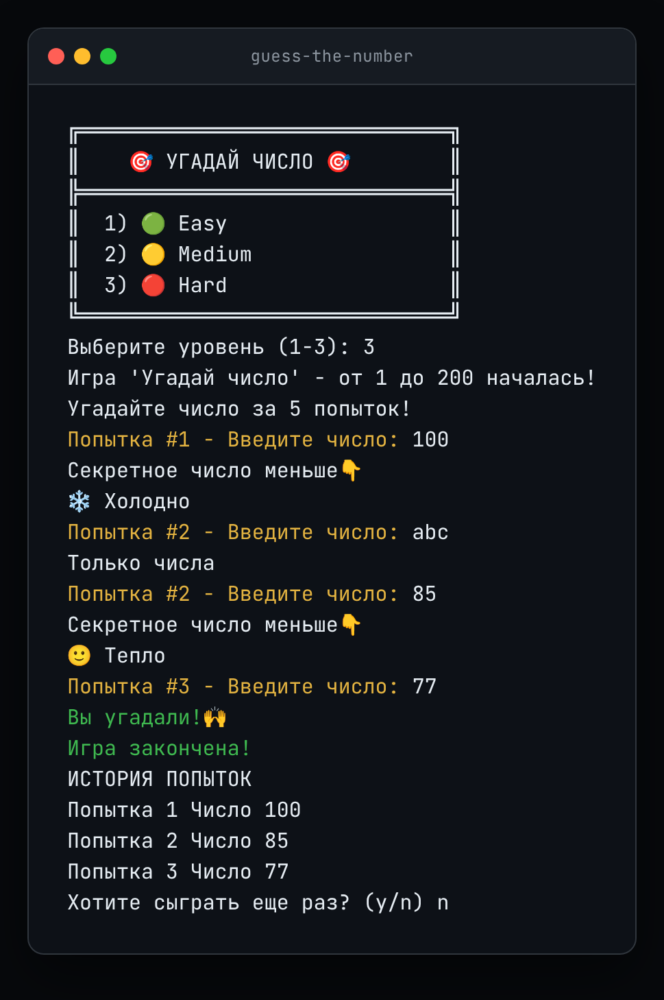

# 🎯 Guess the Number

Консольная игра на Go: угадай секретное число за ограниченное число попыток.




## Возможности

- Три уровня сложности: Easy (1–50, 15 попыток), Medium (1–100, 10), Hard (1–200, 5)
- Подсказки «больше / меньше» и «горячо / тепло / холодно»
- Проверка ввода: нечисловые значения не тратят попытку
- История попыток в конце партии
- Повтор игры без перезапуска
- История всех игр (дата, исход, число попыток) в `results.json`
- Цветной вывод в терминале

## Запуск

```bash
git clone https://github.com/hakurai-cmd/guess-the-number.git
cd guess-the-number
go run .
```

## Пример

```
╔══════════════════════════════╗
║    🎯 УГАДАЙ ЧИСЛО 🎯        ║
╠══════════════════════════════╣
║  1) 🟢 Easy                  ║
║  2) 🟡 Medium                ║
║  3) 🔴 Hard                  ║
╚══════════════════════════════╝
Выберите уровень (1-3): 3
Игра 'Угадай число' - от 1 до 200 началась!
Угадайте число за 5 попыток!
Попытка #1 - Введите число: 100
Секретное число меньше👇
❄️ Холодно
Попытка #2 - Введите число: abc
Только числа
Попытка #2 - Введите число: 85
Секретное число меньше👇
🙂 Тепло
Попытка #3 - Введите число: 77
Вы угадали!🙌
Игра закончена!
ИСТОРИЯ ПОПЫТОК
Попытка 1 Число 100
Попытка 2 Число 85
Попытка 3 Число 77
Хотите сыграть еще раз? (y/n) n
```

## Как устроено

| Функция | Что делает |
|---|---|
| `chooseDifficulty` | меню и выбор сложности |
| `generateNumber` | генерирует секретное число |
| `readNumber` | читает и проверяет ввод |
| `compare` | сравнивает с секретным числом |
| `hint` | подсказка по расстоянию |
| `history` | выводит историю попыток |
| `loadResults` | читает прошлые результаты из JSON |
| `saveResult` | добавляет результат к истории и сохраняет JSON |
| `saveAndReport` | сохраняет и сообщает об ошибке |

## Стек

Go, стандартная библиотека (`bufio`, `strconv`, `math/rand/v2`, `encoding/json`, `time`), [fatih/color](https://github.com/fatih/color)
